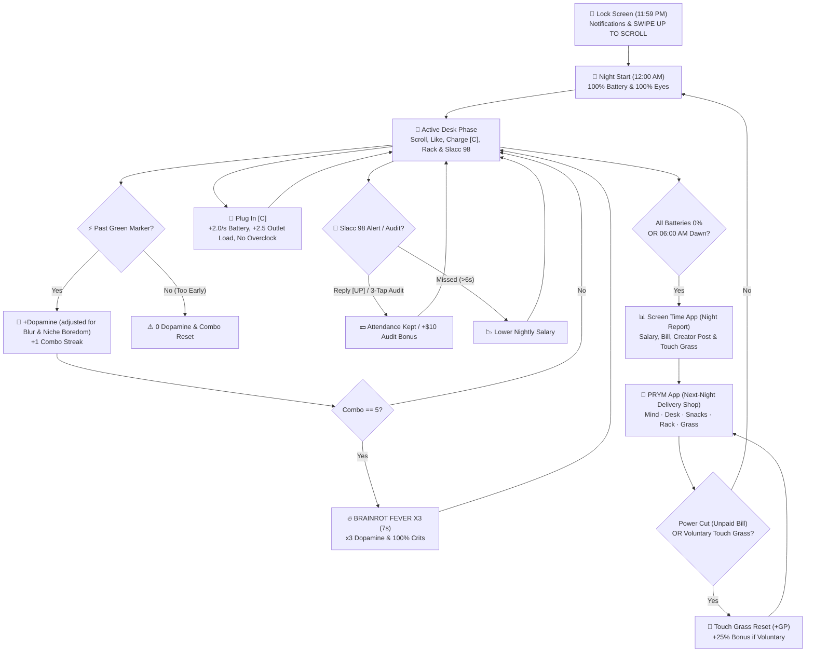

# Game Design & Requirements Document (GDD)
**Project:** Doomscroll Incremental  
**Version:** 6.0 ("3 AM Glow" Design System, Economy Retune & xUnit-Verified Specification)  
**Genre:** Incremental / Active Round-Based Idle / Desk Survival (Rogue-lite)  
**Target Platforms:** PC (Primary — Steam / Itch.io in 16:9, 1920×1080 base canvas) | Mobile (Secondary — Android / iOS in 9:16)  
**Engine & Language:** C# (.NET 8.0) — Godot Engine 4.x (.NET / Mono) with 100% engine-agnostic `Core` and `xUnit` test suite  

> **Changelog from v5.0 to v6.0:**
> 1. **"3 AM Glow" Visual Design System (`Docs/design-system/` & `GlowStyle.cs`):**
>    - **Sticker Pop-Art Direction:** Dark, quiet room (`wall`, `desk`, `lock-ground`) lit only by the phone's `screen-glow`. Every interactive element is a hand-placed sticker (`3px` `ink` border, solid hard drop shadow, semantic signal color, slight 1°–5° tilt).
>    - **Three-Register Typography (`Assets/Fonts/`):** **Bungee** (uppercase HUD, counters, stickers, buttons), **Nunito** (clean body text inside phone apps), and **VT323** (handwritten post-its and the `Slacc 98` laptop terminal).
>    - **Procedural Vector Iconography (`GlowGlyph.cs` & `GlowIconButton.cs`):** 24px grid line-art icons rendered in code (and exported to `Docs/design-system/assets/Icons/*.svg`) on color-coded category tiles.
>    - **Phone-App Screen Architecture (`DeskSceneController.Menus.cs`):** Lock Screen main menu (`11:59` with Mom/Slacc/Doomscroll/Screen Time notifications), **Screen Time** nightly report phone, **PRYM** next-night delivery shop phone with *ARRIVING TOMORROW* desk tray, **Settings** app, and **Album** app (Mythics, Trophies, Stats).
> 2. **Economy Retune & Nightly Tactical Trade-Offs (`Data/balance.json` & `RunFormulas.cs`):**
>    - **Phone #1 Charger (`charger` — Key `C` / `PLUG IN [C]`):** The night (`90s`) is longer than a full battery (`60s`). Plugging in recharges Phone #1 (`+2.0/s`) and animates current along the desk cord, but adds `+2.5` outlet load and blocks overclocking.
>    - **Blurry Eyes Dopamine Penalty (`eyes.blurDopaminePenalty`):** Letting Eye Freshness drop below `55%` progressively cuts Phone #1 dopamine by up to **`-50%`** at full blur (displaying a `BLURRY` effect chip).
>    - **Niche Boredom (`NicheTolerance.cs`):** Finishing standard videos of the same niche on Phone #1 builds boredom (`-5%` dopamine per video up to `-40%`, showing a `BORED` chip and `"z"` on the laptop bars), while other niches recover (`+3%` per video).
>    - **Per-Night Snacks (`SNK_01`, `SNK_02`):** Consumables for the upcoming night only — *Energy Drink* (`$6`, `-40%` eye fatigue tonight) and *Do Not Disturb* (`$0`, mutes the Boss all night for `-50%` salary).
>    - **Creator Mode (`CRT_01`, unlocks Night 7):** Once per night in the report/shop phase, post a video spending `30%` of current Dopamine for Cash (`$8 + $4×(lvl-1) + $1×night`), creating a scalable Dopamine $\rightarrow$ Cash bridge.
>    - **Nightly Salary Raises & Voluntary Prestige Bonus:** Base salary increases by `+$1/night` (`raisePerNight`), and touching grass voluntarily before a power cut grants **`+25%` bonus Grass Points** (`voluntaryBonus`).
> 3. **First-Time Contextual Post-It Tips & Accessibility (`DeskSceneController.Tips.cs` & `GameSettings.cs`):**
>    - Non-intrusive yellow post-it tips appear once per save when a mechanic first matters (low battery, blurry eyes, niche boredom, outlet overload, etc.).
>    - Persistent `user://settings.cfg` with **Text Size (`100% / 125% / 150%`)**, **Reduced Motion**, **Safe Screamer Mode**, Fullscreen, VSync, and audio toggles.
> 4. **70-Test xUnit Verification Suite (`Tests/Doomscroll.Core.Tests`):**
>    - Automated unit tests validating `Data/balance.json` schema/icons, `RunFormulas`, `UpgradeEffects`, `NicheTolerance`, `EconomyService`, and `BuyUpgradeUseCase`.

---

## 1. High Concept & Art Direction ("3 AM Glow")
The player is a sleep-deprived office worker sitting at their desk from `12:00 AM` to `06:00 AM`, scrolling short-form videos while juggling battery life, eye strain, outlet load, secondary rack phones, and late-night `Slacc 98` pings from their boss. Every 3 nights, the electric bill comes due.

### 1.1 Visual Principles ([Docs/design-system/README.md](file:///c:/Users/may/Documents/Doomi/Docs/design-system/README.md))
1. **The phone glows; the room does not:** Night backgrounds use deep `wall` (`#1A1128`), `desk` (`#241734`), and `lock-ground` (`#0E0918`). Light radiates from `screen-glow` behind the main phone.
2. **Every interactive or key status element is a Sticker:** Built via `GlowStyle.Sticker()` with a `3px` solid `ink` (`#0E0918`) border, hard `shadow-sticker` offset, semantic fill color, and subtle hand-placed rotation (`Tilted()`).
3. **One Color = One Meaning (Semantic Signal Palette):**
   - `dopamine` (`#FF3B8B` Pink): Dopamine counter, Mind tab, dopamine prices, primary CTAs (`SWIPE UP`).
   - `cash` (`#A8FF3E` Lime): Cash wallet badge, `$` prices, toggles `ON`, Creator `POST`.
   - `eyes` (`#38E8FF` Cyan): Eyes meter, charger cord/bolt, `START NIGHT`, Desk tab.
   - `mythic` (`#FFD84D` Gold): Mythics, post-it tips, `OPEN THE SHOP`, Snacks tab.
   - `fever` (`#FF8A2B` Orange): Brainrot Fever banner, Outlet meter, upcoming bill warning.
   - `danger` (`#FF3355` Red): Blackout, bill due tonight, dead battery, destructive actions.
   - `grass` (`#47E37A` Green): Touch Grass prestige CTA, Grass tab, `GP` chip.
   - `violet` (`#B57BFF` Violet): Secondary Phone Rack tab and `RADAR` role badge.
4. **Light Phone Apps vs. Dark Night Desk:** Inside phone overlays (**Screen Time**, **PRYM**, **Settings**, **Album**), backgrounds are light `app-paper` / `app-cream` with crisp `white` cards and `ink` text; outside on the desk, everything is night-mode.

---

## 2. Core Gameplay Loop



---

## 3. Functional Requirements (Mechanics & Systems)

### FR-01: Controls, Playback & Phone #1 Charger
* **Unified Input Scheme:**

| Action | Keyboard | Mouse | UI / Mobile Gesture |
| :--- | :--- | :--- | :--- |
| **Next Video (Scroll / Dismiss Spam)** | `Down Arrow` / `Space` / `S` | Wheel Down / Drag Up / `NEXT` Button | Swipe Up on Phone |
| **Give Like** | `Right Arrow` / `D` | Double-Click on Video / Heart Icon | Double Tap |
| **Plug / Unplug Charger** | `C` | Click `PLUG IN [C]` / `CHARGING [C]` | Tap Charger Sticker |
| **Desk Action (Boss / Event / Breaker)** | `Up Arrow` / `W` | Click `REPLY TO BOSS [UP]` / Breaker / Event | Tap Action Button |
| **Overclock Fast-Forward (x2 / x5)** | Hold `Left Arrow` / `Shift` / `A` | Hold Right Click | Touch & Hold |
| **Rack Phone Skip / Claim Mythic** | Keys `2` to `7` | Click Mini-Phone on Desk Rack | Tap Mini-Phone |
| **Pause / Back** | `Escape` | Click Menu Button (`≡`) | Tap Menu / Back |

* **Early Swipe & Green Reward Marker:**
  * Base video duration is `3.0s` (`2.0s` for *Memes*).
  * The green line on the progress bar marks the `AttentionThreshold` (`100%` base, reduced by `-10%` per level of `DOP_01` *Short Attention Span* down to `45%`).
  * Swiping once the bar crosses the green marker awards **100% Dopamine** and advances the **Fever Combo (`+1/5`)**.
* **Phone #1 Charger (`charger`):**
  * Night duration is `90s` while base battery is `60s`.
  * Pressing `C` or clicking `PLUG IN [C]` connects the desk power cord to Phone #1: recharges battery at **`+2.0 charge-seconds/s`**, adds **`+2.5` outlet load**, and disables **x2/x5 Overclock** while plugged in.

### FR-02: Content Niches, Algorithm Training & Niche Boredom
* **4 Content Niches (`niches` in [Data/balance.json](file:///c:/Users/may/Documents/Doomi/Data/balance.json)):**
  * All niches start each night at weight `1.0`. Liking a video adds `+0.25` weight to its niche (up to `6.0`).

| Niche | Dopamine Mult. | Duration | Battery Drain | Eye Fatigue | Special Effect |
| :--- | :--- | :--- | :--- | :--- | :--- |
| **Cats (`cats`)** | `1.10x` | `3.0s` | `1.00x` | `0.80x` | **Restores `+4%` Eye Freshness on Like.** |
| **Gaming (`gaming`)** | `1.45x` | `3.0s` | `1.08x` | `1.25x` | Highest base dopamine per video; higher eye strain. |
| **ASMR (`asmr`)** | `0.90x` | `3.0s` | `0.78x` | `0.65x` | Lowest battery drain (`-22%`) and eye fatigue (`-35%`). |
| **Memes (`memes`)** | `0.85x` | `2.0s` | `1.15x` | `1.10x` | Shorter `2.0s` videos for rapid swipes, combos, and likes. |

* **Niche Boredom ([NicheTolerance.cs](file:///c:/Users/may/Documents/Doomi/Src/Core/Entities/NicheTolerance.cs)):**
  * Completing a standard video on Phone #1 increases boredom for that niche by **`+5%`** (up to a **`-40%` dopamine penalty**) and recovers all other niches by **`-3%`**.
  * When boredom is active on the current video, a `BORED -X%` chip appears under the video badge and the corresponding niche bar on the laptop fades with a `"z"` indicator.

### FR-03: Eye Freshness, Blur Penalty & Brightness
* **Eye Freshness & Blur Penalty (`eyes`):**
  * Decays at `1.1%/s` base (`1.5x` during a room blackout).
  * Below **`55%` Eye Freshness**, Gaussian screen blur (`EyeBlur.gdshader`) and closing eyelid vignettes (`EyelidsVignette.gdshader`) ramp up from `0%` to `100%`.
  * **Dopamine Penalty:** Phone #1 loses up to **`-50%` dopamine** at maximum blur (`BlurDopamineMultiplier`), shown live on the `BLURRY -X%` chip and the `EYES` meter (`RUB YOUR EYES! -X%`).
  * **Blue-Light Glasses (`HW_08`)** cut normalized blur and its dopamine penalty by **`50%`**.
  * **Eye Drops (`$8`)** immediately restore Eye Freshness to **`100%`**.
* **Brightness Modes (`brightness`):**
  * **Low:** `1.0x` Dopamine | `0.65x` Battery Drain | `2.0x` Eye Fatigue.
  * **Normal:** `1.0x` Dopamine | `1.00x` Battery Drain | `1.0x` Eye Fatigue.
  * **High:** `1.3x` Dopamine | `1.50x` Battery Drain | `0.5x` Eye Fatigue | `+2.2` Outlet Load.

### FR-04: Brainrot Fever, Video Categories & Desk Events
* **Brainrot Fever (`combo`):**
  * **5 consecutive valid swipes** trigger `BRAINROT FEVER X3` for **`7.0 seconds`**:
  * Grants **`x3.0` Dopamine** on Phone #1, **100% Critical Likes (`x3.0`)**, hot-pink `shadow-fever-glow` phone border, and `1.25x` Lo-Fi music tempo.
* **Special Video Categories (`feed`):**
  * **Ad / Spam (`12%` base, min `2%`):** Grants `0` dopamine and drains battery at `1.5x`. Swiping it away immediately counts as a valid swipe. Liking an Ad pollutes the feed (`+15%` ad rate for `10` videos).
  * **Screamer (`3%` base):** Stuns the phone for `1.5s`, triggers a screen shake (or calm card if *Safe Screamer Mode* is on), and **restores Eye Freshness to `100%`**. With `DOP_11` (*Jumpscare Junkie*), surviving one pays a **`15x` base dopamine burst**.
  * **3:00 AM Mythic (`0.4%` base, `1.2%` on `MythicRadar`, hard pity at `480` videos):** Pays **`12x` base dopamine** (plus an extra **`1.5x` completion multiplier** if liked first) and unlocks the next entry in the **8-Mythic Album**.
* **Smartphone Spam Popups & 3:00 AM Desk Events:**
  * **Spam Popups:** Appear first at `14–20s`, then every `25–40s`. Dismissing grants **`+15` relief dopamine**.
  * **3:00 AM Desk Event (at `22s`):** Rolls one interactive event per night — *Wi-Fi Lag Spike* (`0.65x` speed until router is kicked for `+35` dopamine), *Shady Sponsor Deal* (`+$20` cash, `+12%` ads tonight), or *Golden Algorithm Wave* (`12s` of `x2.0` dopamine & `100%` crits).

### FR-05: Work Laptop (`Slacc 98`), Salary, Bills & Creator Mode
* **Slacc 98 Alerts & Audits (`laptop`):**
  * Pings every `11–16s` (`1.25x` slower with *Triple Espresso* `HW_05`) with a `6.0s` response window (`+2.5s` extra for audits).
  * `50%` chance of a **1-tap ping** (`REPLY TO BOSS [UP]`) and `50%` chance of a **3-tap Urgent Audit** (`TYPE AUDIT [UP] 1/3 -> 3/3`), which awards an instant **`+$10.00` cash bonus**.
  * **Nightly Salary:** $\text{Salary} = (\text{\$18} + \text{\$1}\times(\text{Day}-1) + \text{\$4}\times\text{GRASS\_03} + \text{MYTHIC\_1}) \times \text{AttendanceRatio}$ (halved if *Do Not Disturb* `SNK_02` is active).
* **Electric Bill (`bill` — Every 3 Nights):**
  $$\text{Bill}(\text{Day}) = \left(30 + 12 \cdot N_{\text{Secondary}} + 8 \cdot N_{\text{Fan}} + 6 \cdot \text{Day}\right) \times 1.14^{\left(\lfloor\frac{\text{Day}-1}{3}\rfloor\right)} \times \left(1 - 0.06 \cdot \text{GRASS\_04}\right)$$
* **Creator Mode (`CRT_01` — Unlocks Night 7):**
  * Once per night after the shift ends, the player can click `POST VIDEO` to spend **`30%` of current Dopamine** in exchange for **`$8 + $4×(level-1) + $1×Day`**.

### FR-06: Outlet Load & Secondary Phone Rack
* **Outlet Load (`outlet`):**
  $$\text{Load} = 1.4 \cdot N_{\text{ActiveSecondary}} + (1.2 \text{ if Fan}) + (2.2 \text{ if HighBright}) + (2.5 \text{ if X2} \mid 5.5 \text{ if X5}) + (2.5 \text{ if Charging})$$
  * **Safe Load:** `4.5` base (`10.0` with **Surge Protector Strip `HW_07`**). Exceeding safe load fills the `OUTLET` meter (`0%` $\rightarrow$ `100%`), tripping a **Room Blackout** (`1.5x` eye fatigue, secondary phones & fan paused) until `[UP]` / `RESET BREAKER` is pressed.
* **Secondary Phone Rack ([MiniPhoneButton.cs](file:///c:/Users/may/Documents/Doomi/Src/Presentation/UI/MiniPhoneButton.cs)):**
  * Up to **6 mini-phones** (`HW_01`), each with a clickable role sticker above it:
    - `STD` (*Standard*): `65%` dopamine factor.
    - `SHIELD` (*Ad Shield*): `65%` dopamine, reduces ad spawn chance by **`85%`** (`0.15x`).
    - `MINER` (*Crypto Miner*): `25%` dopamine, mines **`+$0.35` cash** per completed video.
    - `RADAR` (*Mythic Radar*): `65%` dopamine, triples mythic chance to **`1.2%`** (`0.012`).

---

## 4. Screen Architecture (`1920×1080` Canvas)

1. **Lock Screen (Main Menu):**
   - Left column: tilted `DOOM` / `SCROLL` wordmark, `INCREMENTAL` lime chip, `LAST SAVE` summary card, `"made at 3 AM"` footer.
   - Center phone (`11:59`): planet/moon sky, 4 notification bubbles (*Mom*, *Slacc*, *Doomscroll*, *Screen Time*), `SWIPE UP TO SCROLL` pink CTA, round *Settings*, *Album*, and *Quit* buttons, and *"Start a new game"* confirmation dialog.
   - Right column: 2 tilted post-it notes with rotating tips and the `SAFE SCARE MODE IN SETTINGS` chip.
2. **Active Night Desk:**
   - Top-Left: tilted `NIGHT N/30` cyan sticker, window with blinds that transition from night sky to dawn glow, and sticky notes.
   - Bottom-Left: 6-slot **Mini-Phone Rack** (`STD / SHIELD / MINER / RADAR`), wall socket, power strip with animated charger cord, `OUTLET` meter, and `PLUG IN [C]` sticker.
   - Center: `DOPAMINE` counter + streak sub-label, fever bar, **Primary Smartphone** (with `BLURRY` / `BORED` effect chips, neon vector animation, right-side social rail, green early-swipe marker, and `NEXT` button), plus `EYES` meter, `BRIGHT`, and `EYE DROPS $8`.
   - Right: top-right `$ Cash` badge, `BILL` warning sticker, and menu button (`≡`); center-right **`Slacc 98` Laptop** (boss message, `REPLY TO BOSS [UP]`, 4 niche bars with boredom indicators, live terminal feed); bottom-right digital desk clock (`12:00 AM` $\rightarrow$ `06:00 AM`), coffee mug, drinking bird, and contextual first-time **Tip Toast** post-it.
3. **Screen Time (Night Report Phone) & PRYM (Next-Night Delivery Shop Phone):**
   - At night's end, **Screen Time** opens in the center (`x = 708`) showing total videos watched, best streak/fevers, dopamine earned, top feed niche, salary, electric bill, **Creator Mode** post button, and **Touch Grass** button (with voluntary `+25% GP` bonus).
   - Clicking `OPEN THE SHOP` slides **Screen Time** left (`x = 150`) and opens **PRYM** (`x = 720`) with 5 category tabs (*Mind*, *Desk*, *Snacks*, *Rack*, *Grass*) and the **ARRIVING TOMORROW** sticker tray on the right (`x ≥ 1340`).

---

## 5. Progression & Economy Catalogs ([Data/balance.json](file:///c:/Users/may/Documents/Doomi/Data/balance.json))

### 5.1 Dopamine Upgrades (`Mind` & `Rack` Tabs)

| ID | Name | Category | Base Cost (🧠) | Cost Mult. | Max Lv. | Mechanical Effect |
| :--- | :--- | :--- | :--- | :--- | :--- | :--- |
| `DOP_01` | **Short Attention Span** | Mind | 40 | 2.30x | 5 | `-10%` attention threshold per level (down to `45%`) for full reward. |
| `DOP_02` | **Auto-Scroll Bot** | Mind | 150 | 2.90x | 4 | Auto-swipes Phone #1 once reward is ready (`1.1s - 0.2s×lvl`, min `0.25s`). |
| `DOP_03` | **Speed Overclock** | Mind | 400 | 4.50x | 2 | Hold Shift / Left / RMB for `x2` (`1.65x` drain) at Lv.1, `x5` (`3.5x` drain) at Lv.2. |
| `DOP_04` | **Algorithm Training** | Mind | 60 | 1.95x | 15 | `+35%` base dopamine per video per level (up to `+525%`). |
| `DOP_05` | **Ad-Blocker Script** | Mind | 250 | 2.70x | 3 | `-3%` ad spawn chance per level (`12%` $\rightarrow$ `3%`). |
| `DOP_06` | **Critical Thumb** | Mind | 1,500 | 2.50x | 1 | `15%` critical like chance (`x3.0` bonus). |
| `DOP_07` | **Multi-Screen Sync** | Rack | 400 | 2.60x | 5 | `+12%` dopamine per active secondary phone per level. |
| `DOP_08` | **Viral Trend Surfing** | Mind | 500 | 2.60x | 5 | `+8%` dopamine per consecutive same-niche like per level (max streak `15`). |
| `DOP_10` | **Split-Screen Soap Cutting** | Mind | 4,000 | 2.00x | 1 | `1.45x` (`+45%`) Phone #1 dopamine & soap-cutting sub-window. |
| `DOP_11` | **Jumpscare Junkie** | Mind | 6,000 | 2.00x | 1 | Surviving a screamer pays a `15x` base dopamine burst. |
| `CRT_01` | **Creator Mode** *(Night 7)* | Mind | 4,000 | 3.00x | 5 | Post 1 video/night: spend `30%` dopamine for `$8 + $4×(lvl-1) + $1×night`. |
| `DOP_09` | **Neural Overclock** | Mind | 8,000 | 1.80x | $\infty$ | All dopamine compounds by `1.10^level`. |

### 5.2 Cash Hardware & Per-Night Snacks (`Desk`, `Rack` & `Snacks` Tabs)

| ID | Name | Category | Base Cost ($) | Cost Mult. | Max Lv. | Mechanical Effect |
| :--- | :--- | :--- | :--- | :--- | :--- | :--- |
| `HW_01` | **Secondary Phone** | Rack | $25 | 1.45x | 6 | Adds another auto-scrolling phone to the desk rack (`+$12` base bill each). |
| `HW_02` | **USB Desk Fan** | Desk | $35 | 2.00x | 1 | Reduces extra overclock battery drain by `-30%` (`0.7x`); adds `+1.2` outlet load. |
| `HW_03` | **Emergency Power Bank** | Desk | $45 | 2.00x | 1 | Restores `+35%` backup battery once per night when Phone #1 hits `0%`. |
| `HW_05` | **Triple Espresso** | Snacks | $30 | 1.80x | 1 | `-25%` eye fatigue once blurry, and Boss pings `1.25x` less often. |
| `SNK_01` | **Energy Drink** *(Tonight)* | Snacks | $6 | 1.00x | 1 | **Per-night consumable:** `-40%` eye fatigue rate for the upcoming night. |
| `SNK_02` | **Do Not Disturb** *(Tonight)* | Snacks | $0 | 1.00x | 1 | **Per-night toggle:** Boss cannot ping tonight, but nightly salary is `-50%`. |
| `HW_06` | **Drinking Bird Toy** | Desk | $85 | 2.00x | 1 | Automatically replies to `100%` of Boss pings and audits on the laptop. |
| `HW_07` | **Surge Protector Strip** | Desk | $40 | 2.00x | 1 | Raises safe outlet load from `4.5` to `10.0`. |
| `HW_08` | **Blue-Light Glasses** | Desk | $28 | 2.00x | 1 | Cuts eye blur and its dopamine penalty by `-50%`. |
| `WIN_01` | **Fiber-Optic Neural Link** | Desk | $500 | Unique | 1 | **Day 30 Campaign Victory Upgrade:** Completes Day 30 and unlocks Endless Mode. |

### 5.3 Permanent Prestige Tree (`Grass` Tab — "Touch Grass" 🌱)
* **Formula:** $\text{BaseGP} = \lfloor (\text{TotalRunDopamine} / 450)^{1/2.85} + 0.15 \times \text{Day} \rfloor$ (`+25%` bonus, min `+1`, when triggered voluntarily before a power cut).

| ID | Name | Base Cost (🌱) | Cost Step | Max Lv. | Permanent Cross-Run Effect |
| :--- | :--- | :--- | :--- | :--- | :--- |
| `GRASS_01` | **Dopamine Tolerance** | 1 GP | +1 GP | 10 | `+25%` base dopamine per level. |
| `GRASS_02` | **Grandma's Envelope** | 2 GP | +2 GP | 5 | Start every new run with `+$30` cash per level (up to `$150`). |
| `GRASS_03` | **Remote Promotion** | 2 GP | +2 GP | 5 | `+$4` nightly base salary per level. |
| `GRASS_04` | **Solar Grid Subsidy** | 2 GP | +2 GP | 5 | `-6%` electric bill cost per level (up to `-30%`). |
| `GRASS_05` | **Conditioned Lithium** | 2 GP | +2 GP | 5 | `+12%` max battery capacity on all phones per level (up to `+60%`). |
| `GRASS_06` | **Muscle Memory** | 5 GP | +5 GP | 1 | Start every run with **Auto-Scroll Bot Lv. 1** & **Short Attention Span Lv. 3**. |

### 5.4 Mythics (`8/8`) & Trophies (`8/8`)
* **Mythics (`+15%` dopamine each + passive):**
  - `MYTHIC_0`: `+25%` Base Dopamine (`1.25x`)
  - `MYTHIC_1`: `+$12` Base Daily Salary
  - `MYTHIC_2`: `-20%` Eye Fatigue Drain (`0.80x`)
  - `MYTHIC_3`: Faster Secondary Auto-Scroll (`0.32s` delay)
  - `MYTHIC_4`: `-40%` Ad / Spam Spawn Rate (`0.60x`)
  - `MYTHIC_5`: `+15%` Critical Like Chance
  - `MYTHIC_6`: `+20%` Max Battery Capacity (`1.20x`)
  - `MYTHIC_7`: `x2.0` Global Dopamine Doubler
* **Trophies (`+5%` permanent dopamine each):** `ACH_0` (*10 Early Swipes*), `ACH_1` (*x5 Viral Like Streak*), `ACH_2` (*3 Boss Replies*), `ACH_3` (*2 Secondary Phones*), `ACH_4` (*Desk Fan + Triple Espresso*), `ACH_5` (*Survive 3 Screamers*), `ACH_6` (*First Mythic*), `ACH_7` (*First Touch Grass*).

---

## 6. Technical Architecture & File Map

```text
DoomscrollIncremental/
├── Assets/
│   ├── Fonts/                           # Bungee-Regular.ttf, Nunito-Variable.ttf, VT323-Regular.ttf
│   └── Shaders/                         # EyeBlur.gdshader, EyelidsVignette.gdshader
├── Data/
│   └── balance.json                     # Single source of truth for all gameplay numbers & shop catalog
├── Docs/
│   └── design-system/                   # "3 AM Glow" specification, tokens.json, screens.md, HTML previews & SVGs
├── Src/
│   ├── Core/                            # 100% Pure C# Domain Layer (Zero Godot dependencies)
│   │   ├── Common/EventBus.cs
│   │   ├── Entities/
│   │   │   ├── EyeState.cs
│   │   │   ├── NicheTolerance.cs        # Per-niche boredom penalty & cross-niche recovery
│   │   │   ├── PhoneEntity.cs           # Battery, charging, playback, early-swipe & single-like guards
│   │   │   └── WorkLaptop.cs            # Slacc 98 alerts, multi-tap audits & attendance tracking
│   │   ├── Events/DomainEvents.cs
│   │   ├── Services/
│   │   │   ├── AlgorithmGenerator.cs    # Niche weights, ad pollution & mythic pity counter
│   │   │   ├── BalanceConfig.cs         # Strongly-typed JSON loader & startup validator
│   │   │   ├── EconomyService.cs        # Upgrade scaling, electric bills & Grass Point math
│   │   │   ├── ISaveStorage.cs
│   │   │   ├── RunFormulas.cs           # Pure stateless formulas for dopamine, blur, charger & salary
│   │   │   ├── SaveDataService.cs       # Atomic JSON save persistence & per-night consumable clearing
│   │   │   └── UpgradeEffects.cs        # Dynamic shop card effect descriptions
│   │   └── UseCases/
│   │       ├── BuyUpgradeUseCase.cs
│   │       ├── PrestigeResetUseCase.cs
│   │       └── TurnSession.cs
│   └── Presentation/                    # Godot 4 (.NET) View Layer
│       ├── DeskScene/
│       │   ├── DeskAudioManager.cs      # Procedural Lo-Fi synth & retro SFX
│       │   ├── DeskSceneController.cs   # Core game loop, input, charger, events & playtest bot
│       │   ├── DeskSceneController.Desk.cs  # 1920x1080 desk layout & HUD builders
│       │   ├── DeskSceneController.Menus.cs # Lock screen, Screen Time, PRYM shop, Settings & Album apps
│       │   ├── DeskSceneController.Tips.cs  # Contextual first-time post-it tip toasts
│       │   ├── FileSaveStorage.cs
│       │   └── GameSettings.cs          # Persistent settings (text scale, reduced motion, safe screamer)
│       └── UI/
│           ├── DeskEnvironmentBackdrop.cs   # Animated room, window, strip & charger cord
│           ├── DopamineParticleSystem.cs
│           ├── GlowGlyph.cs             # 24px procedural vector icon renderer
│           ├── GlowIconButton.cs        # Sticker icon button control
│           ├── GlowStyle.cs             # "3 AM Glow" tokens, fonts, sticker & bar style factories
│           ├── MiniPhoneButton.cs       # Interactive secondary rack phone control
│           └── PhoneScreenGraphic.cs    # Procedural video animations & social rail
└── Tests/
    └── Doomscroll.Core.Tests/           # 70 xUnit tests covering balance, economy, formulas & new mechanics
```

---

## 7. Verification & Quality Assurance
1. **Unit Test Suite (`70/70` passing):**
   ```powershell
   $env:DOTNET_ROOT = "$env:USERPROFILE\.dotnet"; $env:PATH = "$env:USERPROFILE\.dotnet;$env:PATH"; & "$env:USERPROFILE\.dotnet\dotnet.exe" test Tests\Doomscroll.Core.Tests\Doomscroll.Core.Tests.csproj
   ```
2. **Godot .NET Build & Automated Playtest Bot (`--playtest`):**
   ```powershell
   $env:DOTNET_ROOT = "$env:USERPROFILE\.dotnet"; $env:PATH = "$env:USERPROFILE\.dotnet;$env:PATH"; & "$env:USERPROFILE\.dotnet\dotnet.exe" build DoomscrollIncremental.csproj
   ```
